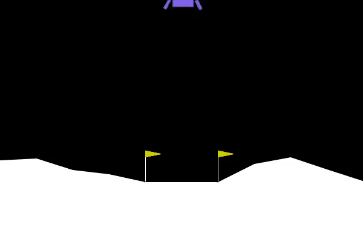
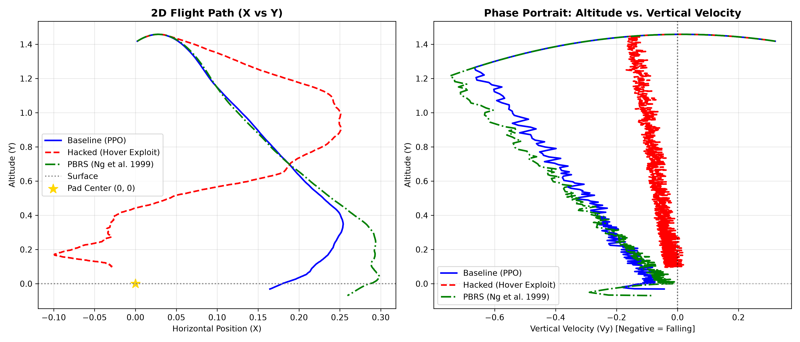

# Autonomous Rocket Landing: PPO & Potential-Based Reward Shaping (PBRS)

> An empirical study of **Reward Hacking vs. Mathematically Sound Policy Invariance** using Proximal Policy Optimization (PPO) on Gymnasium's `LunarLander-v3`.

<p align="center">
  
</p>

<p align="center">
  
  
  
  
</p>

---

## 1. Project Overview

Designing reward functions for complex autonomous control tasks is notoriously difficult. While sparse rewards lead to sample inefficiency, naive dense rewards frequently cause **Reward Hacking** a failure mode where an agent exploits unintended loopholes in the reward function to accumulate points without achieving the primary task.

This project implements a modular, production-grade Reinforcement Learning framework to:
1. **Train an Autonomous Lander**: Master soft-touchdown landings using Proximal Policy Optimization (PPO).
2. **Empirically Demonstrate Reward Hacking**: Introduce a naive heuristic bonus and observe how the agent exploits the environment by hovering indefinitely.
3. **Implement Potential-Based Reward Shaping (PBRS)**: Mathematically reformulate the reward function using Andrew Ng et al.'s (1999) theorem to provide dense learning signals while guaranteeing optimal policy invariance.
4. **Evaluate with Aerospace Metrics**: Perform multi-seed statistical benchmarks and phase-portrait trajectory analysis (Altitude vs. Vertical Velocity).

---

## 2. Theoretical Foundation: Reward Hacking vs. PBRS

### The Naive Reward Trap: The Hover Exploit
In `LunarLander-v3`, an episode lasts up to 1,000 frames. Suppose an engineer adds a naive heuristic bonus to encourage upright and slow descent:
$$\text{Bonus} = +1.0 \quad \text{if } |\theta| < 0.2 \text{ rad and } |v_y| < 0.2 \text{ m/s}$$

- **Fuel Cost**: Firing the main engine consumes $\approx 0.3$ fuel points per frame.
- **Net Margin**: $1.0 - 0.3 = \mathbf{+0.7 \text{ points/frame}}$.
- **The Dilemma**:
  - Landing safely awards a one-time terminal bonus of $+100$ points and ends the episode.
  - Hovering in mid-air yields $+0.7 \times 1,000 = \mathbf{+700 \text{ points}}$.

**Result**: The agent discovers a pathological loophole: **it learns to hover indefinitely, refusing to land until the simulation forcefully truncates at 1,000 steps.**

---

### The Mathematical Fix: Ng, Harada, & Russell (1999) Theorem
To provide dense guidance signals without corrupting the agent's target behavior, any shaping function $F(s, a, s')$ must be expressed as the difference of a potential function $\Phi(s)$:

$$F(s, s') = \gamma \Phi(s') - \Phi(s)$$

where:
- $\Phi(s)$ is a scalar potential function measuring the desirability of state $s$.
- $\gamma$ is the MDP discount factor ($\gamma = 0.99$).
- $s$ is the state before the action; $s'$ is the state after the action.

#### Proof of Policy Invariance (Telescoping Sum)
Over any sequence of steps from $t = 0$ to $T$, the accumulated shaping bonus collapses:

$$\sum_{t=0}^{T-1} \gamma^t F(s_t, s_{t+1}) = \sum_{t=0}^{T-1} \gamma^t \left( \gamma \Phi(s_{t+1}) - \Phi(s_t) \right) = \gamma^T \Phi(s_T) - \Phi(s_0)$$

Because the total shaping bonus depends **solely on the start and terminal states**, cyclic policies (like hovering in place) receive zero net bonus:
$$F(s, s) = \gamma \Phi(s) - \Phi(s) = (\gamma - 1) \Phi(s) < 0$$
Hovering in place actually incurs a continuous penalty of $(\gamma - 1) = -0.01$. The optimal policy $\pi^*$ under the shaped reward remains **100% identical** to the optimal policy of the original task.

#### Implemented Potential Function:
$$\Phi(s) = - \left( \sqrt{x^2 + y^2} + \sqrt{v_x^2 + v_y^2} + 0.5 |\theta| \right)$$

---

## 3. Empirical Benchmark Results

All three trained models were evaluated on the **raw, unshaped `LunarLander-v3` environment** across 20 fixed random seeds (Seeds 0–19) with deterministic policy execution:

| Model | Reward (Mean $\pm$ Std) | Success Rate ($\ge 200$) | Crash Rate ($\le -100$) | Avg Steps to End | Flight Outcome |
| :--- | :---: | :---: | :---: | :---: | :--- |
| **Baseline (PPO)** | **$211.9 \pm 84.2$** | **80.0%** | **0.0%** | **280.4** | Solved environment ($\ge 200$) |
| **Hacked (Hover Exploit)** | **$-59.7 \pm 50.7$** | **0.0%** | **15.0%** | **694.4** | Refused to land; hovered to timeout |
| **PBRS (Ng et al. 1999)** | **$193.3 \pm 97.6$** | **75.0%** | **0.0%** | **314.2** | Preserved safe landing without hacking |

### Key Takeaways:
1. **The Hacked model scored -59.7 on the true landing task**: While training logs showed high apparent rewards due to the $+1.0$ cheat bonus, stripping the wrapper exposed that its actual landing competency was completely destroyed (0.0% success rate, 694.4 average steps).
2. **PBRS preserved optimal policy performance**: PBRS achieved a 0.0% crash rate and 75% success rate, executing swift touchdown flights (~314 steps) without ever exploiting the hover trap.

---

## 4. Trajectory Analysis & Phase Portraits



1. **2D Flight Path ($x$ vs $y$)**:
   - **Baseline (Blue)** & **PBRS (Green)**: Steer directly from the high-altitude drop zone into the landing pad center $(0, 0)$ between the flags.
   - **Hacked (Red)**: Flattens out horizontally at $y \approx 0.4 - 0.6$, drifting and hovering across the sky until the 1,000-frame time limit cuts it off.
2. **Phase Portrait (Altitude $y$ vs Vertical Velocity $v_y$)**:
   - Demonstrates the **safe descent corridor**: safe landings smoothly converge towards $(v_y = 0, y = 0)$.
   - The Hacked policy clusters at zero velocity while still high above the surface.

---

## 5. Repository Architecture

```text
PPO-Lander/
├── configs/
│   ├── baseline_config.yaml      # Pure LunarLander-v3 PPO hyperparameters
│   ├── hacked_config.yaml        # Config exposing the hover reward hack
│   └── pbrs_config.yaml          # Rigorous Potential-Based Reward Shaping
│
├── src/
│   ├── envs/
│   │   ├── __init__.py
│   │   └── wrappers.py           # Custom Gymnasium Wrappers: Hacked vs PBRS
│   ├── models/
│   │   ├── __init__.py
│   │   └── ppo_agent.py          # Config-driven SB3 PPO factory
│   └── utils/
│       ├── __init__.py
│       └── config.py             # Robust YAML configuration loader
│
├── train.py                      # Unified training pipeline with CheckpointCallbacks
├── evaluate.py                   # Multi-seed evaluation runner on raw environment
├── record.py                     # High-res MP4 video rollout recorder
├── plot_trajectories.py          # Trajectory and phase-portrait plotting engine
├── explore_env.py                # Environment sanity check & random agent baseline
│
├── experiments/                  # Output comparison plots, GIF demo & benchmark data
├── models/                       # Trained neural network weights (.zip)
├── videos/                       # Rendered rollout MP4 clips
└── requirements.txt              # Pinned environment dependencies
```

---

## 6. Quickstart & Reproducibility

### 1. Environment Setup
```powershell
# Clone the repository
git clone https://github.com/TheJudge26/Captain-PPO-Lander.git
cd Captain-PPO-Lander

# Create and activate virtual environment (Python 3.11 recommended)
python -m venv .venv
.\.venv\Scripts\Activate.ps1

# Install pinned dependencies
pip install -r requirements.txt
```

### 2. Train the Models
```powershell
# Train Baseline Agent
python train.py --config configs/baseline_config.yaml

# Train Hacked Agent (Hover Exploit)
python train.py --config configs/hacked_config.yaml

# Train Potential-Based Reward Shaping Agent
python train.py --config configs/pbrs_config.yaml
```

### 3. Run Benchmark Evaluation
Evaluate all three models across 20 fixed test seeds:
```powershell
python evaluate.py
```

### 4. Record Flight Videos
```powershell
python record.py --model-path models/baseline/final_model.zip --video-dir videos/baseline
python record.py --model-path models/hacked/final_model.zip --video-dir videos/hacked
python record.py --model-path models/pbrs/final_model.zip --video-dir videos/pbrs
```

### 5. Plot Trajectories & Phase Portraits
```powershell
python plot_trajectories.py
```

---

## 7. References
- Ng, A. Y., Harada, D., & Russell, S. (1999). *"Policy invariance under reward transformations: Theory and application to reward shaping"*. .
- Schulman, J., Wolski, F., Dhariwal, P., Radford, A., & Klimov, O. (2017). *"Proximal policy optimization algorithms"*. .
- Towers et al. (2024). *"Gymnasium: A Standard Interface for Reinforcement Learning Environments"*.
